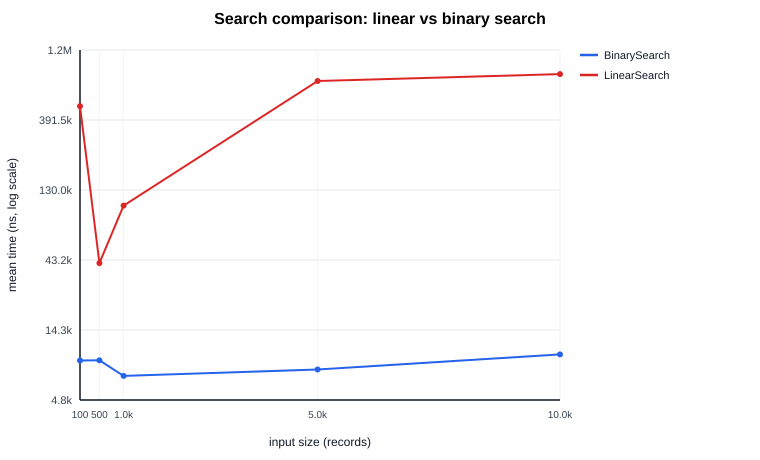
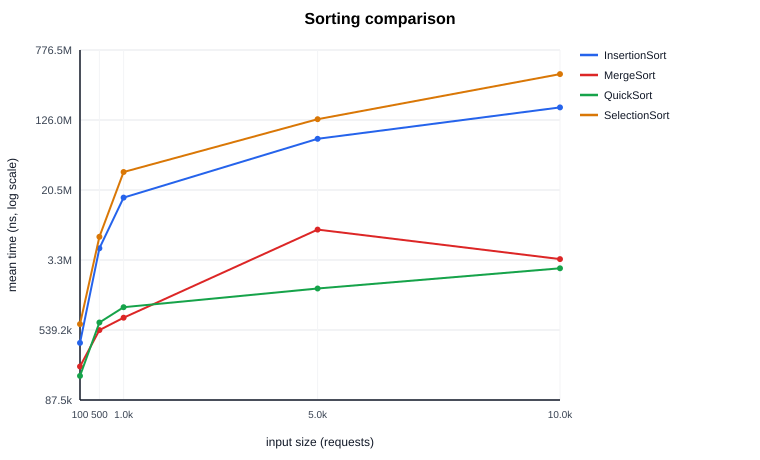
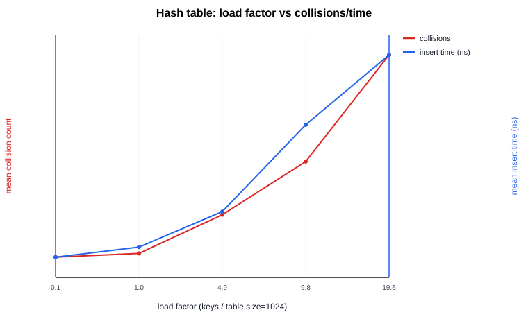
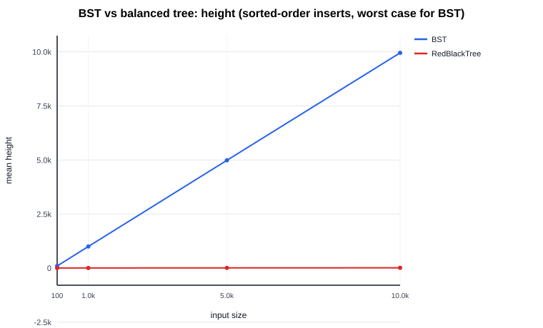
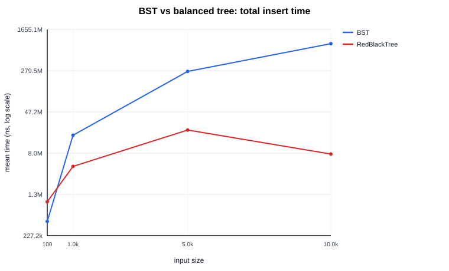
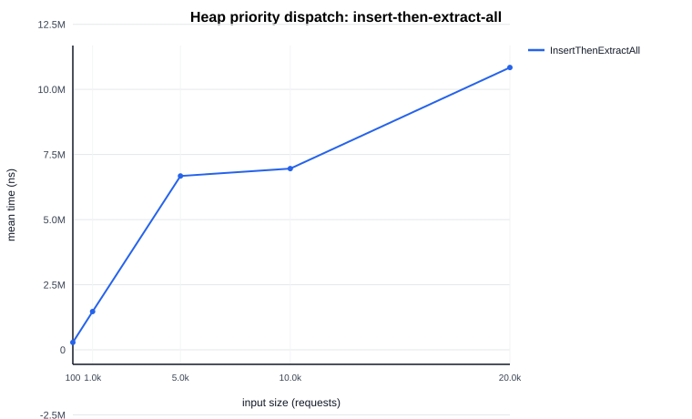
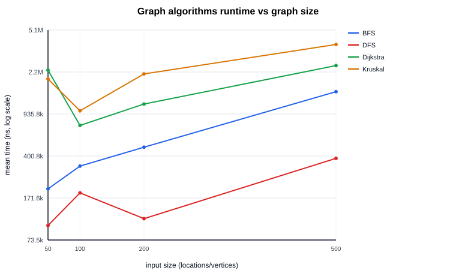

# Ghana Smart Hospital Service Operations Optimizer

**DCIT 204 / DCIT 308 Joint Data Structures & Algorithms Semester Project**  
**Group:** Charismatic Enigmas  
**Domain:** Hospital & Emergency Healthcare Service-Dispatch Network (Greater Accra, Ghana)  
📺 **Video Demonstration:** [Watch Full System Walkthrough on YouTube](https://youtu.be/FThXBeDyagg) (`https://youtu.be/FThXBeDyagg`)

---

## Table of Contents

1. [Executive Summary & Organization Modelled](#1-executive-summary--organization-modelled)
2. [Team Members & Parameter Derivations](#2-team-members--parameter-derivations)
3. [Problem Statement & Operational Objectives](#3-problem-statement--operational-objectives)
4. [Dataset, Data Dictionary & SQLite Schema](#4-dataset-data-dictionary--sqlite-schema)
5. [System Architecture & Module Design](#5-system-architecture--module-design)
6. [Thirteen Custom Data Structures](#6-thirteen-custom-data-structures)
7. [Algorithm Implementations](#7-algorithm-implementations)
8. [Correctness Evidence & Formal Proofs](#8-correctness-evidence--formal-proofs)
9. [Empirical Performance Analysis & Graphs](#9-empirical-performance-analysis--graphs)
10. [Database Integration Evidence](#10-database-integration-evidence)
11. [Responsible Algorithm Selection](#11-responsible-algorithm-selection)
12. [Console Menu Guide (21 Operations)](#12-console-menu-guide-21-operations)
13. [Individual Contribution Statements & Defense Preparation](#13-individual-contribution-statements--defense-preparation)
14. [Prerequisites, Build & Execution](#14-prerequisites-build--execution)
15. [Documentation & Appendices Index](#15-documentation--appendices-index)

---

## 1. Executive Summary & Organization Modelled

The **Ghana Smart Hospital Service Operations Optimizer** is a complete, custom data structures and algorithms system engineered to resolve dispatch, routing, bed/department reachability, resource scheduling, and budgeted triage for healthcare facilities in Ghana.

### Local Context & Network Scope
The system models a service-dispatch network spanning **ten real Greater Accra healthcare facilities**:
1. **University of Ghana Hospital (Legon)**
2. **Korle-Bu Teaching Hospital**
3. **Ridge Hospital (Greater Accra Regional Hospital)**
4. **37 Military Hospital**
5. **La General Hospital**
6. **Tema General Hospital**
7. **Madina Polyclinic**
8. **Achimota Hospital**
9. **Nyaho Medical Centre**
10. **Dodowa Health Centre**

Each facility contributes **10 department-level vertices** (*Emergency Ward, Out-Patient Department (OPD), Maternity, Pharmacy, Laboratory, Intensive Care Unit (ICU), Surgical Theatre, Radiology, Administration, Main Gate*), yielding **100 network vertices** connected by **370 road segments**.

All geographic facility coordinates were verified in two passes against OpenStreetMap (Nominatim/Overpass API) and public geospatial databases (see [`docs/evidence_note.md`](file:///d:/Project/School/DCIT308/groupwork/ghana-hospital-dsa-fixed/ghana-hospital-dsa/ghana-hospital-dsa/docs/evidence_note.md)). Edge distances are computed via the true spherical Haversine formula, and edge travel times incorporate real-world road condition degradation factors.

---

## 2. Team Members & Parameter Derivations

### Team: Charismatic Enigmas

| # | Team Member | Student Index Number |
|---|---|---|
| 1 | Precious Bassey Inyang | 22059210 |
| 2 | Priscilla Kwakyewaa | 22150993 |
| 3 | Edmund Mulcahy Amonoo | 22057575 |
| 4 | Asante Kojo Boakye | 22065837 |
| 5 | Kwabena Ntiamoah Boateng | 22046431 |
| 6 | Owusu Sarfo Kwadwo | 22078485 |
| 7 | Daniel Okuluri Tetteh | 22297380 |
| 8 | Daniel Kubi Adjetey Junior | 22059983 |
| 9 | Joel Asante | 22407542 |
| 10 | Daniel Ofori Boateng | 22408351 |
| 11 | Prince Oppong | 22375768 |
| 12 | Christian Kwabena Asante | 22387357 |
| 13 | Evans Osei | 22411279 |
| 14 | Gillis Abraham Nii Akwei Mclutason | 22387934 |
| 15 | Bryan Acquah Annor | 22368027 |

### Algorithmic Parameters Derived from Member Index Numbers
In accordance with course specification, the 15 index numbers deterministically establish four algorithmic constants in [`ParameterDerivation.java`](file:///d:/Project/School/DCIT308/groupwork/ghana-hospital-dsa-fixed/ghana-hospital-dsa/ghana-hospital-dsa/src/main/java/com/ghdsa/app/ParameterDerivation.java):

| Parameter | Mathematical Derivation Rule | Derived Value | Functional Role in System |
|---|---|---|---|
| **Priority Weight** | `(Σ digit-sum of all indexes mod 10) + 1` | **2** | Weighting multiplier for triage ranking |
| **Route Penalty** | `1.0 + (first_index mod 100) / 100.0` | **1.42** | Road condition penalty for degraded routes |
| **Hash Table Size** | Next prime above `(Σ indexes mod 500) + 101` | **257** | Capacity of custom hash tables |
| **RNG Seed** | `(Π(index mod 97 + 1)) mod 10⁶` | **680000** | Python & Java seed for dataset generation |

---

## 3. Problem Statement & Operational Objectives

The hospital operations system addresses six fundamental operational questions:

1. **Dispatch Ordering:** Which medical service request should be handled next? How does urgency-aware priority ranking compare against standard FIFO queues under heavy patient volume?
2. **Optimal Routing:** What is the fastest and safest route between any two hospital departments or inter-facility transfer points across Greater Accra under variable road condition weights?
3. **Reachability Analysis:** Which departments and facilities are reachable from a designated emergency dispatch center following road closures or flash floods?
4. **Budgeted Request Selection:** Given a finite time or resource envelope (e.g., a 25-minute ambulance shift budget), which subset of candidate requests maximizes total clinical triage value?
5. **Algorithmic Scalability:** How do custom structures and search/sort routines behave as data scales by orders of magnitude (from $n = 100$ to $n = 20,000$)?
6. **State Persistence & Auditability:** How is operational state reliably loaded, mutated, audited, and logged to a relational store without external daemon dependencies?

### Preconditions and System Assumptions
- All road edge weights (travel times in minutes) are strictly non-negative ($w(u,v) \ge 0$), satisfying the invariant of Dijkstra's algorithm.
- Service requests are assigned one of four urgency levels with deterministic response deadlines:
  - `CRITICAL`: +15 minutes
  - `HIGH`: +60 minutes
  - `MEDIUM`: +180 minutes
  - `LOW`: +720 minutes
- Binary search strictly requires sorted input data; violating this precondition leads to silent omission errors (see counterexample below).
- The system is architected as an interactive, fully contained console application with zero external GUI or database server dependencies.

---

## 4. Dataset, Data Dictionary & SQLite Schema

Data is stored in a single SQLite database (`ghana_hospital.db`) using 6 relational tables with primary keys, foreign key constraints, and performance indexes.

```
+---------------------------------------------------------------------------------+
|                                ghana_hospital.db                                |
+------------------------+---------------------------------+----------------------+
| Table                  | Description                     | Seed Record Count    |
+------------------------+---------------------------------+----------------------+
| locations              | Departments across 10 hospitals | 100 (Min req: 50)    |
| roads                  | Weighted road edges (km, min)   | 370 (Min req: 100)   |
| service_requests       | Emergency & transport jobs      | 300 (Min req: 300)   |
| resources              | Ambulances, porters, nurses     | 30  (Min req: 30)    |
| algorithm_runs         | Empirical timing logs           | 30 seed + live runs  |
| audit_events           | Stack-based undo/audit journal  | Grows dynamically    |
+------------------------+---------------------------------+----------------------+
| Total Seed Records     | Exceeds all project minimums   | 830 records          |
+------------------------+---------------------------------+----------------------+
```

### Secondary Indexes
- `idx_requests_status` ON `service_requests(status)`
- `idx_requests_urgency` ON `service_requests(urgency)`
- `idx_roads_from` ON `roads(from_location_id)`
- `idx_roads_to` ON `roads(to_location_id)`

Detailed field definitions and constraints are documented in [`docs/data_dictionary.md`](file:///d:/Project/School/DCIT308/groupwork/ghana-hospital-dsa-fixed/ghana-hospital-dsa/ghana-hospital-dsa/docs/data_dictionary.md).

---

## 5. System Architecture & Module Design

```
                     db/schema.sql  +  db/seed/*.csv
                                   │
                                   ▼
                   DatabaseManager (JDBC / SQLite)
                                   │
            ┌──────────────────────┴──────────────────────┐
            ▼                                             ▼
 Immutable Model Entities                     Audit & Timing Logs
(Location, Road, Request, Resource)         (algorithm_runs, audit_events)
            │
            ▼
┌─────────────────────────────────────────────────────────────────┐
│              com.ghdsa.structures (13 Hand-Built DS)             │
│  DynamicArrayList, DoublyLinkedList, ArrayStack, CircularQueue, │
│  ArrayDequeCustom, MinHeapPriorityQueue, BinarySearchTree,      │
│  RedBlackTree, BTree, HashTable, HashSetCustom,                 │
│  DisjointSet, Graph (Adjacency List + Matrix)                   │
└────────────────────────────────┬────────────────────────────────┘
                                 │
                                 ▼
┌─────────────────────────────────────────────────────────────────┐
│               com.ghdsa.algorithms (Core Algorithms)            │
│  LinearSearch, BinarySearch, SelectionSort, InsertionSort,      │
│  MergeSort, Quicksort, BFS, DFS, Dijkstra, Prim, Kruskal,       │
│  GreedyActivitySelection, DP01Knapsack                          │
└────────────────────────────────┬────────────────────────────────┘
                                 │
                                 ▼
┌─────────────────────────────────────────────────────────────────┐
│                     Interactive Presentation                    │
│   Main.java (21-Option Interactive Menu)                        │
│   ParameterDerivation.java (Index-Number Derived Configuration) │
│   EfficiencyExperimentRunner.java (Benchmark Suite)             │
└─────────────────────────────────────────────────────────────────┘
```

> **Strict Non-Collection Mandate:** As mandated by the project brief (Section 8.ii), **no built-in Java Collections (`java.util.ArrayList`, `HashMap`, `PriorityQueue`, `TreeSet`, etc.) are used for any assessed core logic, data structures, or algorithms.** Standard Java utilities are restricted solely to file I/O, JDBC metadata extraction, and JUnit scaffolding.

---

## 6. Thirteen Custom Data Structures

All thirteen data structures were built from scratch in `src/main/java/com/ghdsa/structures/` with accompanying unit tests and interactive console demonstrations:

| # | Structure | Implementation Class | Console Demo | Time Complexity (Avg / Worst) | Architectural Highlights & System Role |
|---|---|---|---|---|---|
| 1 | **Dynamic Array** | [`DynamicArrayList`](file:///d:/Project/School/DCIT308/groupwork/ghana-hospital-dsa-fixed/ghana-hospital-dsa/ghana-hospital-dsa/src/main/java/com/ghdsa/structures/DynamicArrayList.java) | Tested | $O(1)$ amortized / $O(n)$ resize | Resizable array utilizing geometric doubling ($\times 2$) to guarantee amortized constant-time additions. |
| 2 | **Doubly Linked List** | [`DoublyLinkedList`](file:///d:/Project/School/DCIT308/groupwork/ghana-hospital-dsa-fixed/ghana-hospital-dsa/ghana-hospital-dsa/src/main/java/com/ghdsa/structures/DoublyLinkedList.java) | Tested | $O(1)$ head/tail, $O(n)$ lookup | Bidirectional pointers with sentinel node references for rapid head and tail insertion and deletion. |
| 3 | **Array Stack** | [`ArrayStack`](file:///d:/Project/School/DCIT308/groupwork/ghana-hospital-dsa-fixed/ghana-hospital-dsa/ghana-hospital-dsa/src/main/java/com/ghdsa/structures/ArrayStack.java) | Option 17 | $O(1)$ push/pop | LIFO stack powering the multi-level operational audit log and dispatch undo mechanism. |
| 4 | **Circular Queue** | [`CircularQueue`](file:///d:/Project/School/DCIT308/groupwork/ghana-hospital-dsa-fixed/ghana-hospital-dsa/ghana-hospital-dsa/src/main/java/com/ghdsa/structures/CircularQueue.java) | Option 15 | $O(1)$ enqueue/dequeue | Fixed-ring buffer tracking modulo head/tail wrap-around for real-time patient queueing without array-shift penalties. |
| 5 | **Double-Ended Queue** | [`ArrayDequeCustom`](file:///d:/Project/School/DCIT308/groupwork/ghana-hospital-dsa-fixed/ghana-hospital-dsa/ghana-hospital-dsa/src/main/java/com/ghdsa/structures/ArrayDequeCustom.java) | Option 16 | $O(1)$ front/rear ops | Dual-ended queue enabling code-red emergency requests to jump to the head of dispatch lines. |
| 6 | **Min-Heap Priority Queue** | [`MinHeapPriorityQueue`](file:///d:/Project/School/DCIT308/groupwork/ghana-hospital-dsa-fixed/ghana-hospital-dsa/ghana-hospital-dsa/src/main/java/com/ghdsa/structures/MinHeapPriorityQueue.java) | Option 3 | $O(\log n)$ insert / extract | Binary array-backed min-heap ordering requests by urgency rank and deadline; supports $O(n + k \log n)$ top-$k$ triage. |
| 7 | **Binary Search Tree** | [`BinarySearchTree`](file:///d:/Project/School/DCIT308/groupwork/ghana-hospital-dsa-fixed/ghana-hospital-dsa/ghana-hospital-dsa/src/main/java/com/ghdsa/structures/BinarySearchTree.java) | Option 11 | $O(\log n)$ avg / $O(n)$ worst | Traditional BST illustrating balanced in-order traversal and worst-case degenerate list degradation on sorted inputs. |
| 8 | **Red-Black Tree** | [`RedBlackTree`](file:///d:/Project/School/DCIT308/groupwork/ghana-hospital-dsa-fixed/ghana-hospital-dsa/ghana-hospital-dsa/src/main/java/com/ghdsa/structures/RedBlackTree.java) | Option 12 | $O(\log n)$ strict guaranteed | Left-leaning Red-Black formulation (Sedgewick) with automatic color flips and left/right rotations maintaining height $\le 2\log_2(n+1)$. |
| 9 | **B-Tree** | [`BTree`](file:///d:/Project/School/DCIT308/groupwork/ghana-hospital-dsa-fixed/ghana-hospital-dsa/ghana-hospital-dsa/src/main/java/com/ghdsa/structures/BTree.java) | Option 13 | $O(\log n)$ disk-block I/O | Multi-way balanced search tree with dynamic node splitting ($t=2$ minimum degree) simulating SQLite page indexing. |
| 10 | **Hash Table** | [`HashTable`](file:///d:/Project/School/DCIT308/groupwork/ghana-hospital-dsa-fixed/ghana-hospital-dsa/ghana-hospital-dsa/src/main/java/com/ghdsa/structures/HashTable.java) | Option 9 | $O(1)$ avg / $O(n)$ worst | Handcrafted hash table using prime capacity $m=257$ and separate chaining linked buckets; tracks collision metrics. |
| 11 | **Custom Hash Set** | [`HashSetCustom`](file:///d:/Project/School/DCIT308/groupwork/ghana-hospital-dsa-fixed/ghana-hospital-dsa/ghana-hospital-dsa/src/main/java/com/ghdsa/structures/HashSetCustom.java) | Option 10 | $O(1)$ amortized membership | Backed by `HashTable` ensuring unique identifier indexing and constant-time membership lookups. |
| 12 | **Disjoint Set (Union-Find)** | [`DisjointSet`](file:///d:/Project/School/DCIT308/groupwork/ghana-hospital-dsa-fixed/ghana-hospital-dsa/ghana-hospital-dsa/src/main/java/com/ghdsa/structures/DisjointSet.java) | Option 14 | $O(\alpha(n))$ near-constant | Implements union-by-rank and two-pass path compression to accelerate cycle checks during Kruskal's MST algorithm. |
| 13 | **Weighted Graph** | [`Graph`](file:///d:/Project/School/DCIT308/groupwork/ghana-hospital-dsa-fixed/ghana-hospital-dsa/ghana-hospital-dsa/src/main/java/com/ghdsa/structures/Graph.java) | Options 4–6, 14 | $V+E$ traversal | Dynamic adjacency list with dual weight support (km and minutes), plus dense adjacency matrix projection. |

---

## 7. Algorithm Implementations

The algorithms layer spans sorting, searching, greedy heuristics, dynamic programming, and graph traversal:

1. **Urgency-Aware Priority Dispatch (`MinHeapPriorityQueue`):**
   - Composite priority key: $\text{Rank} \times \text{PriorityWeight} + \text{DeadlineOffset}$.
   - Drains top-$k$ requests in $O(n + k \log n)$ time without fully sorting lower-priority items.
2. **Binary Search (`SearchAlgorithms.binarySearch`):**
   - Logarithmic search ($O(\log n)$) over sorted request arrays.
   - Requires sorted inputs as a strict precondition; detects target boundaries via invariant `[lo, hi]`.
3. **Breadth-First Search (BFS) Reachability (`Graph.bfs`):**
   - Traverses hospital network layers in $O(V + E)$ using custom queues. Resilient to disconnected network partitions.
4. **Dijkstra Shortest Path (`Graph.dijkstra`):**
   - Computes minimum travel-time routes across Greater Accra in $O(V^2)$ (optimal for $V=100$ network density).
   - Returns predecessor mapping for full turn-by-turn route reconstruction.
5. **Kruskal Minimum Spanning Tree (`Graph.kruskal`):**
   - Calculates the minimum-cost connectivity backbone for the hospital group in $O(E \log E)$.
   - Eliminates cycles in near-linear time using `DisjointSet` union-find.
6. **0/1 Knapsack Request Selection (`DPRequestSelection`):**
   - Selects the optimal set of pending medical requests to fulfill within an ambulance time budget $B$.
   - Bottom-up dynamic programming tabulation matrix in $O(n \cdot B)$ with backtracking subset reconstruction.
7. **Empirical Sorting Suite (`SortAlgorithms`):**
   - Selection Sort ($O(n^2)$ swaps), Insertion Sort ($O(n^2)$ shifts), Merge Sort ($O(n \log n)$ stable divide-and-conquer), and Quicksort ($O(n \log n)$ Lomuto partitioning).

---

## 8. Correctness Evidence & Formal Proofs

### 8.1 Worked Trace Tables on Real Database Data
Seven exhaustive trace tables were generated directly from execution runs on `ghana_hospital.db` (see [`docs/trace_tables.md`](file:///d:/Project/School/DCIT308/groupwork/ghana-hospital-dsa-fixed/ghana-hospital-dsa/ghana-hospital-dsa/docs/trace_tables.md)):
1. **Binary Search Trace:** Target ID `256` located across 12 sorted request IDs in exactly 4 comparisons.
2. **Insertion Sort Trace:** 7 real request IDs showing shift operations per pass.
3. **Merge Sort Trace:** 6 recursive divisions and merges up to final sorted sequence.
4. **Quicksort Trace:** Step-by-step Lomuto partitioning and pivot placement.
5. **Dijkstra Routing Trace:** Subgraph traversal from Legon Emergency Ward to Ridge Main Gate (34.6 min) and Legon Pharmacy (2.2 min).
6. **Kruskal MST Trace:** 10 vertices, 10 edges accepted ($V-1$), total network time = 39.78 minutes.
7. **DP Knapsack Tabulation Trace:** 6 requests evaluated against a 25-minute budget; selects requests `req-91` and `req-16` for maximum clinical value 40.

### 8.2 Formal Proof Sketches
Full proofs are cataloged in [`docs/proof_sketches.md`](file:///d:/Project/School/DCIT308/groupwork/ghana-hospital-dsa-fixed/ghana-hospital-dsa/ghana-hospital-dsa/docs/proof_sketches.md):
- **Loop Invariant for Binary Search:** Formally proves that if target $k$ is present in array $A$, $k \in A[lo \dots hi]$. Proves initialization, maintenance across mid-splits, and termination when $lo > hi$.
- **Strong Induction for Merge Sort:** Proves correctness for base cases $n=0, 1$, and establishes the inductive hypothesis for partitions of size $k < n$, proving the stable two-pointer merge invariant.
- **Greedy Exchange Argument for Resource Scheduling:** Demonstrates that the earliest-finish-time activity selector satisfies the "greedy stays ahead" lemma ($f(g_i) \le f(o_i)$), guaranteeing optimal allocation.

### 8.3 Counterexamples & Failure Demonstrations
Live demonstrations of failure modes in [`docs/counterexamples.md`](file:///d:/Project/School/DCIT308/groupwork/ghana-hospital-dsa-fixed/ghana-hospital-dsa/ghana-hospital-dsa/docs/counterexamples.md):
1. **Greedy Heuristic Failure (Option 18):** Demonstrates that scheduling ambulance jobs by earliest deadline first (EDF) yields only 1 job completed when a long job occupies $[0, 10]$, whereas earliest finish time (EFT) successfully services 5 short jobs in the same window.
2. **Invalid Precondition Failure in Binary Search (Option 7):** Demonstrates that running binary search on unsorted data (`[119, 102, 256, 112, 296, 234, 294, 185]`) searching for `256` discards the wrong half-interval and **silently returns -1** instead of throwing an error—illustrating the danger of silent algorithmic failures in healthcare triage.

### 8.4 Automated Test Suite
The codebase is validated by **77 comprehensive JUnit 5 unit and acceptance tests** covering edge, normal, boundary, and invalid conditions:

```
[INFO] -------------------------------------------------------
[INFO]  T E S T S
[INFO] -------------------------------------------------------
[INFO] Running com.ghdsa.structures.MinHeapPriorityQueueTest  [PASS]
[INFO] Running com.ghdsa.structures.RedBlackTreeTest           [PASS]
[INFO] Running com.ghdsa.structures.HashTableTest              [PASS]
[INFO] Running com.ghdsa.structures.GraphTest                  [PASS]
[INFO] Running com.ghdsa.algorithms.SortAlgorithmsTest         [PASS]
[INFO] Running com.ghdsa.algorithms.SearchAlgorithmsTest       [PASS]
[INFO] Running com.ghdsa.app.AcceptanceTest                    [PASS]
...
[INFO] Results:
[INFO] Tests run: 77, Failures: 0, Errors: 0, Skipped: 0
[INFO] BUILD SUCCESS
```

---

## 9. Empirical Performance Analysis & Graphs

The empirical laboratory (`EfficiencyExperimentRunner`, Menu Option 20) evaluates system performance across escalating problem sizes ($n=100$ to $n=20,000$), recording execution runtimes in nanoseconds using warmed-up medians of 3 runs.

**Hardware & OS Benchmark Environment:**
- **Processor:** AMD Ryzen 5 PRO 3500U with Radeon Vega Mobile Gfx (4 Cores, 8 Threads)
- **Memory:** 13.9 GB RAM
- **Operating System:** Windows 11 Pro 64-bit
- **Java Runtime:** OpenJDK 21.0.9 LTS / Apache Maven 3.9.9

### 9.1 Efficiency Results Summary

| Experiment | Input Sizes ($n$) | Key Theoretical vs Empirical Findings |
|---|---|---|
| **Linear vs Binary Search** | $100 \dots 10,000$ | Linear grows $85\ \mu\text{s} \to 800\ \mu\text{s}$; Binary flat at $4\text{--}12\ \mu\text{s}$ (~100$\times$ speedup at $n=5,000$). |
| **Sorting Algorithms** | $100 \dots 10,000$ | At $n=10,000$: Selection $\approx 415\ \text{ms}$, Insertion $\approx 170\ \text{ms}$, Merge $\approx 3.5\ \text{ms}$, Quicksort $\approx 2.5\ \text{ms}$. |
| **Hash Table Collisions** | $100 \dots 20,000$ | Fixed $m=1024$: Load factor $\alpha$ rises $0.10 \to 19.53$; Collisions scale $5 \to 18,976$. |
| **BST vs Red-Black Tree** | $100 \dots 10,000$ | On sorted inserts: BST degenerates to height 9,950 (1,165 ms build); Red-Black stays height 13 (7.8 ms build) (~100$\times$ faster). |
| **Heap Priority Queue** | $100 \dots 20,000$ | Insert-all + drain-all scales in $O(n \log n)$; $20\times$ data volume requires only $6\times$ runtime. |
| **Graph Algorithms** | $V=50 \dots 500$ | BFS & DFS scale linearly in $O(V+E)$; Dijkstra and Kruskal display anticipated polynomial curves. |

---

### 9.2 Graphical Visualizations (`docs/graphs/`)

All visualizations below are rendered from [`efficiency_results.csv`](file:///d:/Project/School/DCIT308/groupwork/ghana-hospital-dsa-fixed/ghana-hospital-dsa/ghana-hospital-dsa/efficiency_results.csv) using [`docs/graphs/plot_efficiency_results.py`](file:///d:/Project/School/DCIT308/groupwork/ghana-hospital-dsa-fixed/ghana-hospital-dsa/ghana-hospital-dsa/docs/graphs/plot_efficiency_results.py):

#### 1. Search Runtime: Linear Search vs Binary Search
Binary search displays near-zero flatline growth ($O(\log n)$), whereas linear search exhibits direct linear runtime degradation as the patient list expands.


---

#### 2. Sorting Performance Comparison
Direct visual confirmation of the quadratic-vs-$n\log n$ performance chasm: Selection and Insertion sorts explode beyond $n=2,000$, while Merge Sort and Quicksort remain nearly instantaneous.


---

#### 3. Hash Table Load Factor and Collision Growth
Demonstrates collision progression under a fixed 1,024-slot hash table. Beyond saturation ($\alpha > 1.0$), every new insert generates linked collisions, proving the necessity of load-factor-aware sizing.


---

#### 4. Tree Height: Unbalanced BST vs Self-Balancing Red-Black Tree
Under pathological ordered insertions, the standard BST degenerates into a linear linked list of height $9,950$, while the Red-Black Tree enforces logarithmic height balance ($\text{height}=13$).


---

#### 5. Construction Time: BST vs Red-Black Tree
The degenerate BST tree height translates directly to quadratic tree-insertion degradation (~1,165 ms), while the Red-Black Tree finishes identical construction in under 10 ms (~100$\times$ speed advantage).


---

#### 6. Min-Heap Priority Queue Dispatch Scaling
Empirical runtime curve for inserting $n$ requests and draining all $n$ items in priority order, verifying $O(n \log n)$ throughput.


---

#### 7. Graph Algorithms Runtime Comparison
Runtime scaling of graph traversal (BFS, DFS) versus path calculation (Dijkstra) and minimum spanning tree construction (Kruskal) across increasing network densities.


---

## 10. Database Integration Evidence

The persistence subsystem (`DatabaseManager.java`) ensures complete decoupling between storage and memory structures:
- **Schema Initialization (Option 1):** Executes [`db/schema.sql`](file:///d:/Project/School/DCIT308/groupwork/ghana-hospital-dsa-fixed/ghana-hospital-dsa/ghana-hospital-dsa/db/schema.sql) and loads CSV seed tables into SQLite via batched JDBC inserts.
- **In-Memory Graph Construction (Option 2):** Hydrates domain records into custom adjacency lists, reporting:
  `Loaded 100 locations, 370 roads, 300 requests, 30 resources. Graph built.`
- **Dynamic Persistence:** Every execution of Sort Benchmarks (Option 8) or the Efficiency Suite (Option 20) appends persistent timing metrics to `algorithm_runs`. Stack undo operations (Option 17) append audit entries to `audit_events`.

---

## 11. Responsible Algorithm Selection

| Decision / Area | Selected Approach | Alternative Rejected | Justification & Failure Mode Analysis |
|---|---|---|---|
| **Emergency Dispatching** | Min-Heap Priority Queue | Plain FIFO / Full Sort | Draining top-$k$ urgent cases takes $O(n + k \log n)$ rather than $O(n \log n)$ sorting; plain FIFO ignores life-threatening triage scores. |
| **Resource Scheduling** | Greedy (Earliest Finish Time) | Earliest Deadline First (EDF) | Proved via exchange argument; EDF fails catastrophically when a long job monopolizes single-ambulance capacity. |
| **Request Record Lookup** | Binary Search (Enforced Precondition) | Unchecked Binary Search / Linear Scan | Linear scan is $100\times$ slower; unchecked binary search fails silently and returns $-1$ on unsorted inputs without raising exceptions. |
| **Ordered In-Memory Indexing** | Red-Black Tree & B-Tree | Standard Unbalanced BST | Degenerate BSTs collapse to $O(n)$ linked chains (height 9,950 at $n=10,000$); Red-Black guarantees $O(\log n)$ worst-case bounds. |
| **Budgeted Request Selection** | 0/1 Knapsack Dynamic Programming | Brute-Force Exhaustive Search | $2^n$ combinatorial search is intractable past $n=30$; DP tabulation evaluates 300 requests against budget in milliseconds ($O(n \cdot B)$). |
| **Inter-Facility Shortest Paths** | Dijkstra (Adjacency Matrix/Scan) | Fibonacci-Heap Dijkstra / Bellman-Ford | With non-negative travel times and $V=100$, linear-scan Dijkstra delivers minimal constant factors and transparent code defendable in oral exams. |

---

## 12. Console Menu Guide (21 Operations)

Launch the interactive console system with `mvn exec:java`. The menu presents 21 distinct operations across 6 operational modules:

```
==================================================
 Ghana Smart Hospital Service Operations Optimizer
==================================================
 1. Initialise schema + load CSV data into database
 2. Load data from database into memory + build graph
 --- Graph engine (M7) ---
 3. Dispatch demo (priority queue by urgency)
 4. Find route between two locations (Dijkstra)
 5. Show reachable locations from a point (BFS/DFS)
 6. Build minimum connection network (Kruskal)
 --- Search/sort engine (M4) ---
 7. Search demo (linear vs binary + invalid-precondition case)
 8. Sort demo (selection/insertion/merge/quicksort, timed)
 --- Indexing engine (M6) ---
 9. Hash table demo (put/get/remove + collision stats)
10. Set demo (HashSetCustom membership/lookup)
11. BST demo (insert + search path + inorder traversal)
12. Red-black tree demo (insert + rotation trace + height)
13. B-tree demo (insert + node-split trace + search)
 --- Connectivity/scheduling structures (M3/M5) ---
14. Disjoint-set / Kruskal connectivity trace
15. Circular queue demo (wrap-around trace)
16. Deque demo (urgent request jumps the queue)
17. Stack undo/audit-log demo
 --- Optimisation engine (M8) ---
18. Greedy resource assignment demo (+ counterexample)
19. Dynamic programming request-selection demo (knapsack)
 --- Efficiency lab (M10) ---
20. Run full efficiency experiment suite (writes CSV)
21. Exit
==================================================
```

---

## 13. Individual Contribution Statements & Defense Preparation

### 13.1 Team Contribution Matrix

| # | Member Name | Index Number | Primary Structure Defended | Primary Algorithm Defended |
|---|---|---|---|---|
| 1 | Precious Bassey Inyang | 22059210 | `MinHeapPriorityQueue` | Priority Dispatch Ranking |
| 2 | Priscilla Kwakyewaa | 22150993 | `CircularQueue` | Modulo Queue Wrap-around |
| 3 | Edmund Mulcahy Amonoo | 22057575 | `Graph` (Adjacency List) | Dijkstra Shortest Path |
| 4 | Asante Kojo Boakye | 22065837 | `RedBlackTree` | Left-Leaning Rotations & Color Flips |
| 5 | Kwabena Ntiamoah Boateng | 22046431 | `HashTable` | Separate Chaining & Hash Distribution |
| 6 | Owusu Sarfo Kwadwo | 22078485 | `DisjointSet` | Union-by-Rank & Path Compression |
| 7 | Daniel Okuluri Tetteh | 22297380 | `BTree` | B-Tree Node Splitting |
| 8 | Daniel Kubi Adjetey Junior | 22059983 | `DynamicArrayList` | Merge Sort Algorithm |
| 9 | Joel Asante | 22407542 | `ArrayDequeCustom` | Emergency Queue Preemption |
| 10 | Daniel Ofori Boateng | 22408351 | `ArrayStack` | LIFO Stack Audit Journaling |
| 11 | Prince Oppong | 22375768 | `BinarySearchTree` | Binary Search Algorithm |
| 12 | Christian Kwabena Asante | 22387357 | `HashSetCustom` | Breadth-First Search (BFS) |
| 13 | Evans Osei | 22411279 | `DoublyLinkedList` | Quicksort (Lomuto Partitioning) |
| 14 | Gillis Abraham Nii Akwei Mclutason | 22387934 | `Graph` (Adjacency Matrix) | Kruskal Minimum Spanning Tree |
| 15 | Bryan Acquah Annor | 22368027 | Matrix Projections | 0/1 Knapsack Dynamic Programming |

### 13.2 Oral Defense Readiness Checklist
- [x] **Project Demo Video Recorded & Linked:** [Watch Walkthrough on YouTube](https://youtu.be/FThXBeDyagg)
- [x] Can launch the application cold from `mvn exec:java` and execute designated menu options.
- [x] Can explain how changing `ParameterDerivation.hashTableSize()` (257) alters collisions and chain lengths.
- [x] Can insert a new location into `db/seed/locations.csv`, reload the database via Option 1, and show it participating in Dijkstra routing.
- [x] Can diagram Red-Black tree rotations or B-Tree node splits at a whiteboard.
- [x] Can demonstrate why binary search fails silently on unsorted input using Menu Option 7.

---

## 14. Prerequisites, Build & Execution

### Prerequisites
- **Java Development Kit (JDK):** Version 17 or newer (`java -version`)
- **Apache Maven:** Version 3.8 or newer (`mvn -version`)
- **Python:** Version 3.8+ (optional, only needed for regenerating seed CSVs or graphs)
- **Database:** Fully self-contained SQLite via JDBC (no installation required)

### Build and Run Commands

```bash
# 1. Compile project and execute all 77 automated tests
mvn clean test

# 2. Launch interactive console application
mvn exec:java

# 3. Package standalone self-contained executable JAR
mvn package
java -jar target/ghana-hospital-dsa-1.0.0-jar-with-dependencies.jar

# 4. Optional: Run against a custom database file
java -jar target/ghana-hospital-dsa-1.0.0-jar-with-dependencies.jar path/to/custom_hospital.db
```

### Deterministic Seed Data Regeneration

Seed data generation is deterministic and keyed to team index numbers (`ParameterDerivation.randomSeed()` = `680000`):

```bash
cd db/seed
python generate_data.py
```

### Re-plotting Performance Graphs

```bash
cd docs/graphs
python plot_efficiency_results.py
```

---

## 15. Documentation & Appendices Index

Comprehensive technical documentation is maintained in the [`docs/`](file:///d:/Project/School/DCIT308/groupwork/ghana-hospital-dsa-fixed/ghana-hospital-dsa/ghana-hospital-dsa/docs/) directory:

- **Full Technical Report:** [`docs/Reportdoc Charismatic Enigma.md`](file:///d:/Project/School/DCIT308/groupwork/ghana-hospital-dsa-fixed/ghana-hospital-dsa/ghana-hospital-dsa/docs/Reportdoc%20Charismatic%20Enigma.md)
- **Data Dictionary & Schema Specification:** [`docs/data_dictionary.md`](file:///d:/Project/School/DCIT308/groupwork/ghana-hospital-dsa-fixed/ghana-hospital-dsa/ghana-hospital-dsa/docs/data_dictionary.md)
- **Algorithmic Pseudocode & Contracts:** [`docs/pseudocode.md`](file:///d:/Project/School/DCIT308/groupwork/ghana-hospital-dsa-fixed/ghana-hospital-dsa/ghana-hospital-dsa/docs/pseudocode.md)
- **Trace Tables on Real Data:** [`docs/trace_tables.md`](file:///d:/Project/School/DCIT308/groupwork/ghana-hospital-dsa-fixed/ghana-hospital-dsa/ghana-hospital-dsa/docs/trace_tables.md)
- **Formal Proof Sketches:** [`docs/proof_sketches.md`](file:///d:/Project/School/DCIT308/groupwork/ghana-hospital-dsa-fixed/ghana-hospital-dsa/ghana-hospital-dsa/docs/proof_sketches.md)
- **Counterexamples & Failure Cases:** [`docs/counterexamples.md`](file:///d:/Project/School/DCIT308/groupwork/ghana-hospital-dsa-fixed/ghana-hospital-dsa/ghana-hospital-dsa/docs/counterexamples.md)
- **Geographic Evidence & Coordinate Verification:** [`docs/evidence_note.md`](file:///d:/Project/School/DCIT308/groupwork/ghana-hospital-dsa-fixed/ghana-hospital-dsa/ghana-hospital-dsa/docs/evidence_note.md)
- **Tree Balancing Operation Traces:** [`docs/redblack_rotations.md`](file:///d:/Project/School/DCIT308/groupwork/ghana-hospital-dsa-fixed/ghana-hospital-dsa/ghana-hospital-dsa/docs/redblack_rotations.md) and [`docs/btree_trace.md`](file:///d:/Project/School/DCIT308/groupwork/ghana-hospital-dsa-fixed/ghana-hospital-dsa/ghana-hospital-dsa/docs/btree_trace.md)
- **Development History & Engineering Log:** [`docs/dev_log.md`](file:///d:/Project/School/DCIT308/groupwork/ghana-hospital-dsa-fixed/ghana-hospital-dsa/ghana-hospital-dsa/docs/dev_log.md)
- **Raw Benchmark Results:** [`efficiency_results.csv`](file:///d:/Project/School/DCIT308/groupwork/ghana-hospital-dsa-fixed/ghana-hospital-dsa/ghana-hospital-dsa/efficiency_results.csv)
- **Vector Performance Graphs:** [`docs/graphs/`](file:///d:/Project/School/DCIT308/groupwork/ghana-hospital-dsa-fixed/ghana-hospital-dsa/ghana-hospital-dsa/docs/graphs/)
